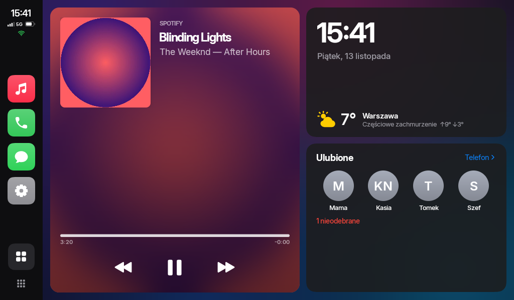
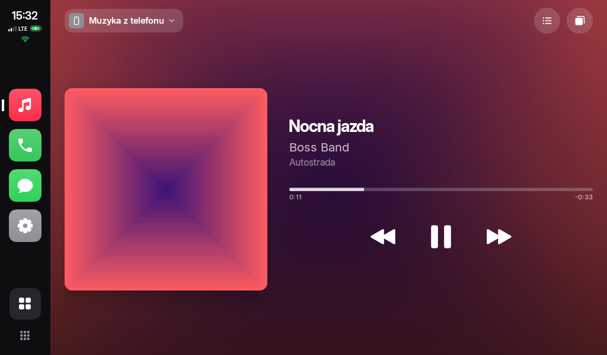
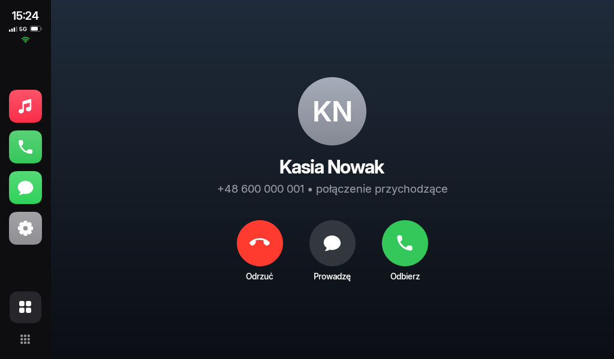
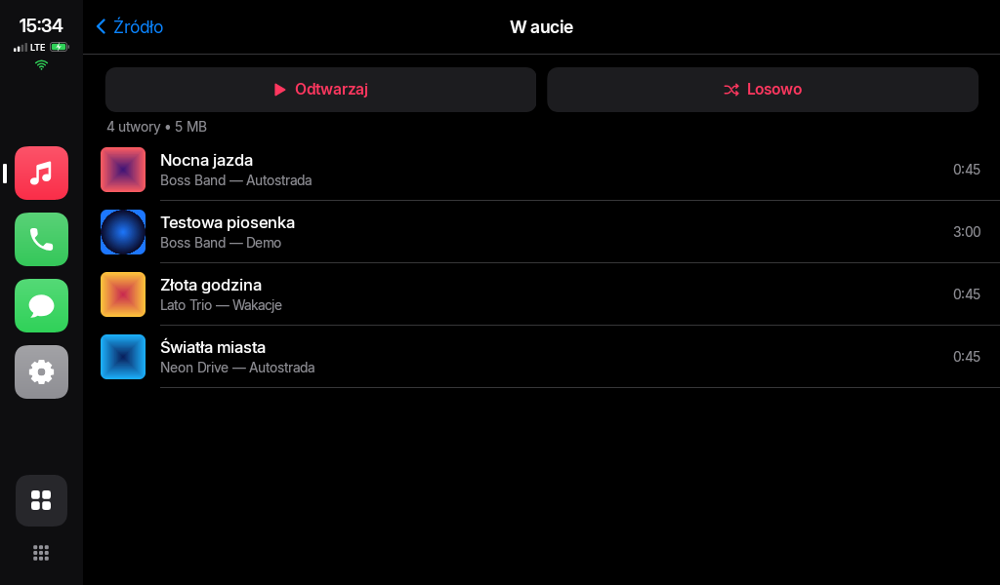
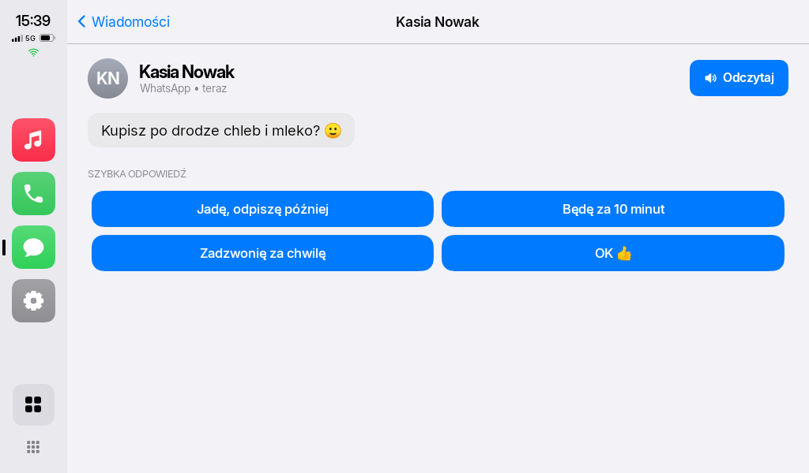
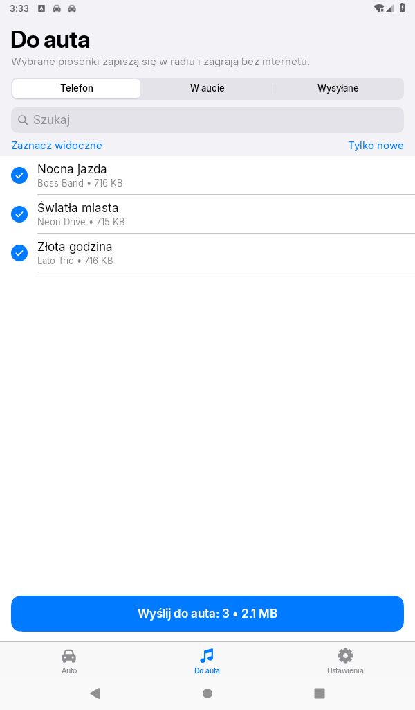
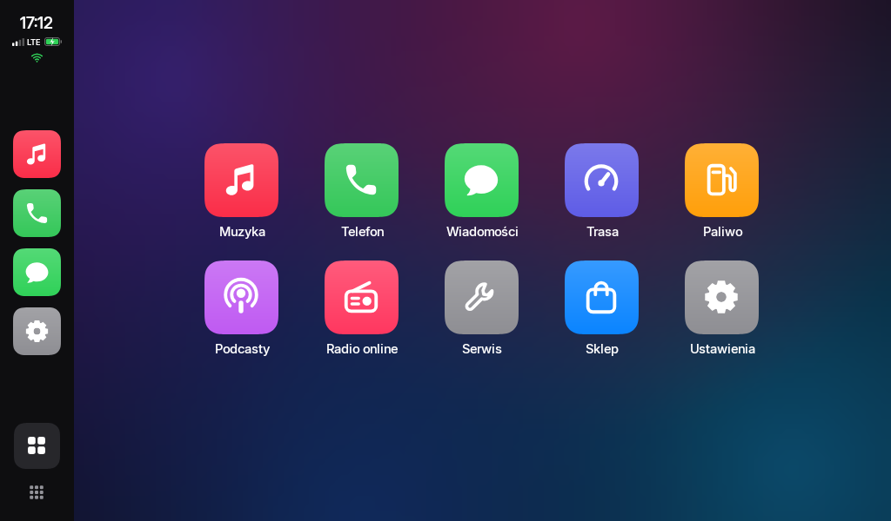
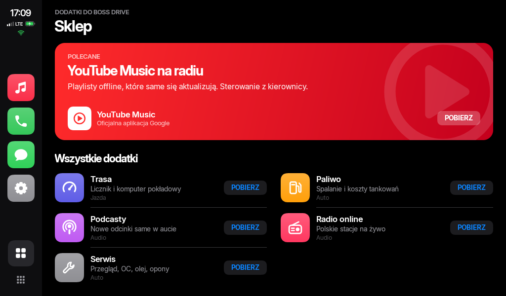
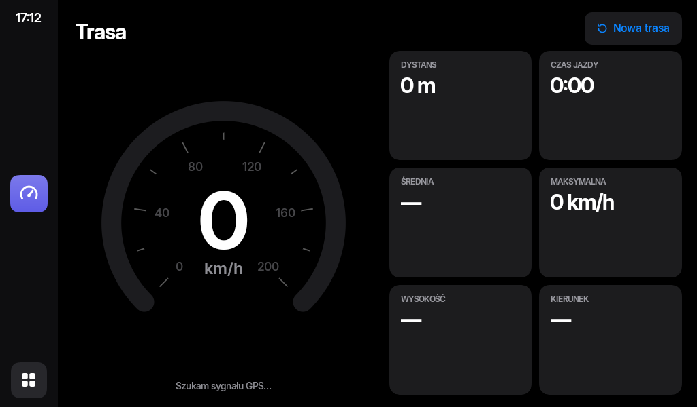

# Boss Drive

Ekran w stylu CarPlay dla radia samochodowego z Androidem (testowane pod Android 9, 1 GB RAM, 1024×600)
oraz aplikacja na telefon, która nim steruje.

| Radio – Start | Radio – Teraz gra | Radio – Połączenie |
|---|---|---|
|  |  |  |
| **Radio – Biblioteka offline** | **Radio – Wiadomość** | **Telefon – Do auta** |
|  |  |  |

| **Radio – Aplikacje** | **Radio – Sklep** | **Dodatek: Trasa** |
|---|---|---|
|  |  |  |

## Instalacja (5 minut)

1. **Radio:** skopiuj `dist/BossDrive-Radio.apk` na pendrive albo pobierz go w przeglądarce radia
   i zainstaluj. Uruchom aplikację raz ręcznie (Android wymaga tego, żeby potem startowała sama).
2. **Telefon:** zainstaluj `dist/BossDrive-Telefon.apk`, otwórz i przejdź listę „Dokończ konfigurację”
   (jeden przycisk na każde uprawnienie).
3. **Wi-Fi:** w telefonie włącz hotspot, a w radiu połącz Wi-Fi z tym hotspotem (jednorazowo —
   radio zapamięta sieć).
4. **Bluetooth:** telefon sparowany z radiem jak dotąd — dźwięk i rozmowy dalej lecą przez Bluetooth radia.

Od teraz: wsiadasz, odpalasz auto → radio otwiera Boss Drive, telefon rozpoznaje auto po Bluetooth
i łączy się sam. Nic nie trzeba klikać.

> Android 13+ (telefon): jeżeli przełącznik uprawnień jest szary, wejdź w
> Ustawienia → Aplikacje → Boss Drive → ⋮ → **Zezwól na ustawienia z ograniczeniami**.

## Co potrafi

**Muzyka**
- steruje **dowolną** aplikacją muzyczną na telefonie (Spotify, YouTube Music, Tidal, radio internetowe…):
  play/pauza, następny, poprzedni, przewijanie, kolejka, okładki i rozmyte tło jak w Apple Music,
- przeglądanie i odtwarzanie muzyki zapisanej w telefonie (albumy, wykonawcy, utwory, playlisty),
- wybór źródła (lista aplikacji muzycznych z telefonu),
- **muzyka offline w aucie:** w telefonie zaznaczasz piosenki → „Wyślij do auta” → zapisują się w pamięci radia
  i grają bez internetu i bez telefonu. Kolejka czeka, aż wsiądziesz do auta; przerwane wysyłanie
  wznawia się od miejsca, w którym stanęło. Można też „Udostępnij → Wyślij do auta” z dowolnego menedżera plików,
- przyciski na kierownicy działają dla muzyki offline (MediaSession).

**Telefon**
- ekran połączenia jak w CarPlay: Odbierz / Odrzuć / **„Prowadzę”** (odrzuca i wysyła SMS
  „Prowadzę samochód, oddzwonię niedługo.”),
- Ulubione (duże kafelki), Ostatnie, Kontakty, Klawiatura,
- muzyka offline sama pauzuje się na czas rozmowy i wraca po niej,
- sam dźwięk rozmowy idzie przez zestaw głośnomówiący radia (Bluetooth HFP) — najlepsza możliwa jakość
  i redukcja echa po stronie radia.

**Wiadomości**
- banery z SMS, WhatsApp, Messengera, Telegrama, Signala i innych,
- „Odczytaj” — telefon czyta wiadomość na głos przez głośniki auta (muzyka się ścisza),
- szybkie odpowiedzi jednym dotknięciem (bez pisania w trakcie jazdy).

**Dodatkowe pomysły**
- Dashboard: teraz gra + zegar + pogoda (z lokalizacji telefonu) + ulubione kontakty,
- pasek statusu: zasięg, sieć (5G/LTE) i bateria telefonu,
- motyw jasny/ciemny automatycznie wg wschodu i zachodu słońca,
- **parking:** telefon zapamiętuje, gdzie zostawiłeś auto (po rozłączeniu Bluetooth),
- ochrona przed obcym telefonem: radio pyta, zanim połączy się z nowym urządzeniem.

## Sklep z dodatkami (opcjonalne)

Przycisk Home w docku przełącza Dashboard ↔ ekran aplikacji (jak w CarPlay). Tam jest **Sklep**.
Dodatki są **częścią Boss Drive** — „Pobierz” dodaje je do ekranu aplikacji, bez instalowania osobnych aplikacji,
bez okien instalatora i ikon w systemie radia. Kod dodatku ładuje się do pamięci dopiero, gdy go otworzysz.

| Dodatek | Co robi |
|---|---|
| **YouTube Music** | jedyny zewnętrzny: oficjalna aplikacja Google ze Sklepu Play na radiu; Boss Drive nią steruje („Teraz gra”, kierownica) |
| **Trasa** | prędkościomierz z GPS, dystans, czas jazdy, średnia, maksimum, wysokość, kierunek |
| **Paliwo** | tankowania wpisywane dużą klawiaturą, realne spalanie (do pełna), koszt 100 km, wydatki w miesiącu |
| **Podcasty** | subskrypcje, nowe odcinki pobierają się same w tle, słuchanie offline, pamięta miejsce |
| **Radio online** | polskie stacje internetowe (radio-browser.info), ulubione, przełączanie stacji z kierownicy |
| **Serwis** | przegląd, OC/AC, olej (data + km), opony sezonowe — ostrzeżenia przed terminem |
| **Parkomat** | odliczanie opłaconego postoju, powiadomienia 10 i 5 min przed końcem, przedłużanie |
| **Dyktafon** | notatki głosowe jednym dużym przyciskiem (mikrofon radia), odsłuch w aucie |
| **Koszt podróży** | koszt paliwa trasy i podział na osoby; spalanie i cena z dodatku Paliwo |
| **Pary** (gra) | memory, 3 poziomy, ruchy, czas, rekordy |
| **Kółko i krzyżyk** (gra) | z komputerem (łatwy / średni / nie do pokonania) albo we dwoje |

Gry blokują się automatycznie w trakcie jazdy (GPS > 8 km/h) i wracają po zatrzymaniu.
Nieoficjalnych klientów YouTube (jak OpenTune) ani pobierania z YouTube do MP3 Boss Drive celowo nie zawiera.

## Połączenie: hotspot tylko raz, potem Bluetooth

Przy pierwszym połączeniu przez hotspot radio przekazuje telefonowi swoją nazwę Bluetooth — kolejne
połączenia idą już same przez Bluetooth. Hotspot przydaje się tylko do szybkiego wysyłania piosenek.
(Działa, jeśli radio ma standardowy Bluetooth Androida — status widać w Ustawienia → Bluetooth na radiu.)

**Dźwięk gra z telefonu zamiast z radia?** Telefon musi być połączony z radiem przez Bluetooth z włączonym
„Dźwiękiem multimediów”. Boss Drive to wykrywa i podpowiada na obu ekranach. W wielu radiach trzeba też
przełączyć źródło na „Muzykę BT” — przycisk Bluetooth w „Teraz gra” robi to jednym dotknięciem
(albo automatycznie: Ustawienia → Bluetooth → Przełączaj automatycznie).

## Optymalizacja pod 1 GB RAM

- bez AppCompat, bez Compose, bez zewnętrznych bibliotek — czyste Android Views rysowane ręcznie,
- APK radia ~460 KB razem z 10 dodatkami, w działaniu ~16–22 MB RAM (zmierzone na emulatorze Android 9),
- jeden wątek tła o niskim priorytecie, okładki zmniejszane do 400 px, rozmycie liczone na miniaturce 40×40,
- listy na `ListView` z recyklingiem widoków, cache okładek z limitem 3 MB oddawany przy `onTrimMemory`,
- animacje i odliczanie czasu działają tylko na widocznym ekranie,
- beacon UDP milknie po połączeniu, przesyłanie plików strumieniowe (64 KB naraz, stała pamięć).

## Jak to działa technicznie

```
Telefon (Boss Drive)                                   Radio (Boss Drive Car)
┌──────────────────────────┐   Wi-Fi (hotspot)  TCP   ┌──────────────────────────┐
│ MediaSessionManager ─────┼──────────────────────────▶│ Dashboard / Teraz gra     │
│ Telefon/Kontakty/SMS ────┼◀──── komendy ────────────┤ Połączenia / Wiadomości   │
│ Powiadomienia ───────────┤   Bluetooth RFCOMM        │ SQLite + pliki offline    │
│ Kolejka „Do auta” ───────┼─── (zapasowo) ───────────▶│ MediaPlayer + MediaSession│
└──────────────────────────┘                           └──────────────────────────┘
        dźwięk muzyki i rozmów: zwykły Bluetooth radia (A2DP / HFP)
```

- wykrywanie: radio rozgłasza beacon UDP (port 47870), telefon wysyła sondy (47871), połączenie TCP 47872,
- protokół: ramki `[długość JSON][długość danych][JSON][dane binarne]`, ping co 4 s,
  pakiety sterujące mają pierwszeństwo przed przesyłanym plikiem,
- zapasowo Bluetooth RFCOMM (jeśli radio ma standardowy stos Bluetooth; wiele chińskich radii
  ma osobny moduł BT i wtedy działa tylko Wi-Fi).

## Budowanie

```bash
./gradlew assembleRelease
# phone/build/outputs/apk/release/phone-release.apk   (zawiera APK dodatków)
# radio/build/outputs/apk/release/radio-release.apk
# addons/*/build/outputs/apk/release/*.apk
```

`tools/fake_phone.py` — atrapa telefonu do testowania radia bez telefonu
(`adb forward tcp:47872 tcp:47872 && python3 tools/fake_phone.py 127.0.0.1 music contacts msg ring`).
`tools/gen_icons.py` — generator ikon w stylu SF.

## Uwagi

- Wygląd odwzorowuje iOS/CarPlay (kolory systemowe, ciągłe zaokrąglenia rogów, typografia, animacje),
  ale bez materiałów Apple: zamiast fontu SF jest Inter (licencja OFL), ikony są narysowane od nowa.
- Utwory ze Spotify/Apple Music/YouTube Music są zabezpieczone (DRM) — offline do auta wysyłasz
  własne pliki MP3/FLAC/M4A. Sterowanie działa dla wszystkich aplikacji.
- Klucz podpisu (`keystore/`) jest w repo celowo, żeby kolejne wersje instalowały się jako aktualizacja.
